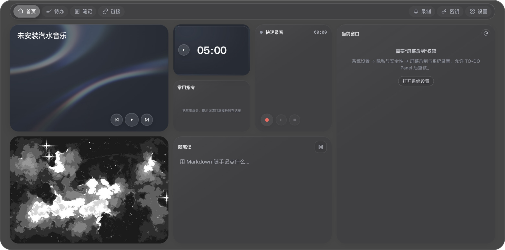
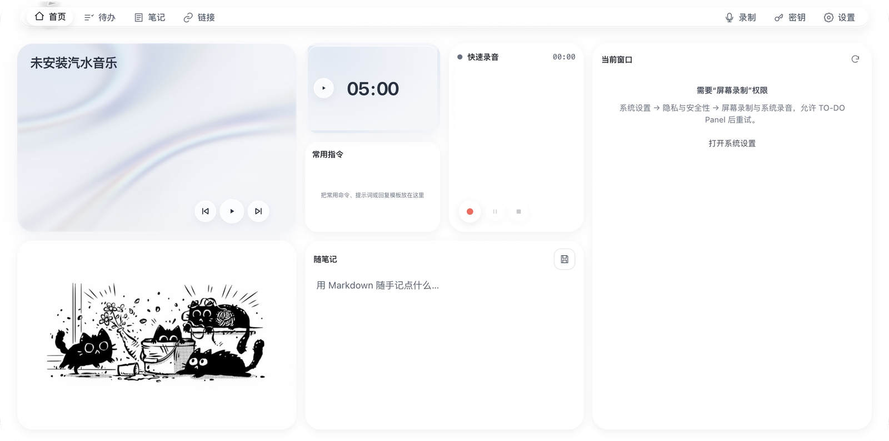
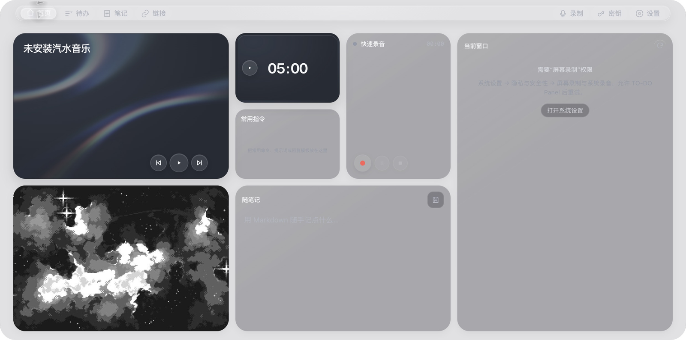
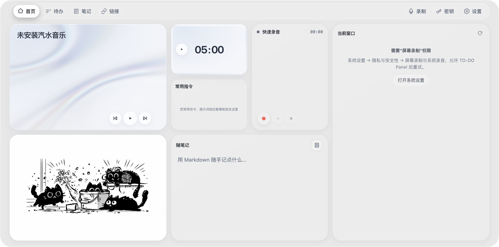
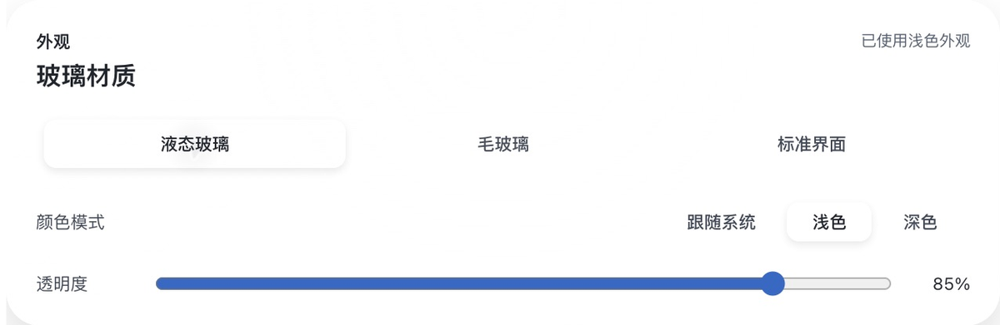
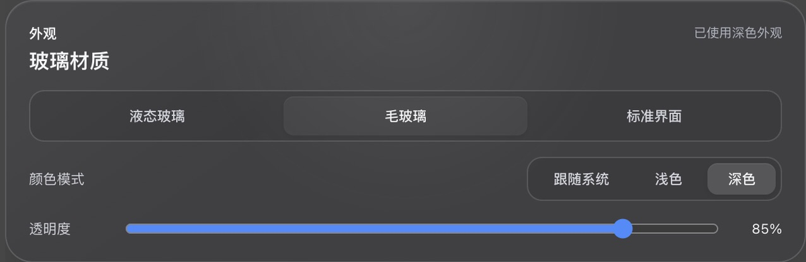
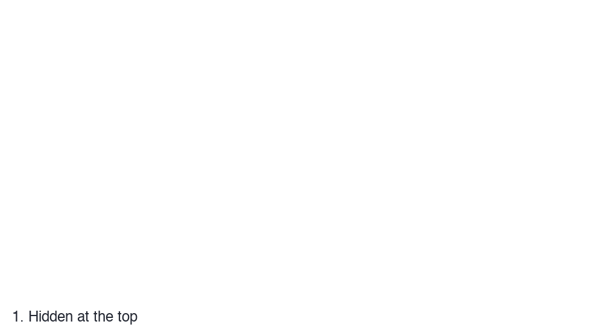

# TO-DO Panel Glass · macOS 液态玻璃界面改造

在 TO-DO Panel 的待办与桌面工作区上，加入原生玻璃材质、浅深色外观和从屏幕顶部垂直拉出的面板。



*真实运行的预览版窗口，毛玻璃 · 深色 · 85% 透明度。窗口截图不包含完整桌面背景，不是合成效果图。*

**[下载 Apple Silicon 预览包（ZIP）](https://github.com/YEMIN11238/to-do-panel-glass/releases/download/v1.1.2-glass-preview.1/TO-DO-Glass-Materials-Corrected-arm64.zip)** · [发布说明与校验文件](https://github.com/YEMIN11238/to-do-panel-glass/releases/tag/v1.1.2-glass-preview.1)

**Apple Silicon / arm64 · 液态玻璃需要 macOS 26+ · 预览版 · 本地开发签名，未经过 Apple 公证。** Intel、Windows 和较旧系统不在本预览包的验收范围内。

三个核心改进：

1. **两种原生玻璃材质**：液态使用 `NSGlassEffectView` 的通透材质；毛玻璃使用独立的原生背景模糊层，另有标准实色界面。
2. **可以自己选择的外观**：跟随系统、手动浅色或深色，以及透明度设置；音乐、时钟与默认封面也随主题调整。
3. **从顶端拉出面板**：保留点击与快捷键唤出，新增垂直下拉和上推交互，展开位置固定，不把面板变成自由拖动的窗口。

## 看效果

### 液态玻璃、毛玻璃与浅深色

以下四张均来自实际预览包，窗口位置、布局与透明度（85%）一致。没有把桌面图片贴进界面，也没有增强截图里的模糊或高光。

| 液态玻璃 · 浅色 | 液态玻璃 · 深色 |
| --- | --- |
|  |  |

| 毛玻璃 · 浅色 | 毛玻璃 · 深色 |
| --- | --- |
|  |  |

**截图范围**：这些是原生窗口捕获。完整桌面录屏没有获得系统权限，因此无法用这些图判断真实桌面的透底、折射或扩散强度；液态深色在窗口捕获中也可能显得偏亮。下载后可在自己的桌面背景下比较两种材质。

在右上角「设置 → 玻璃材质」选择材质、颜色和透明度。下面是实际设置面板的裁切，已去掉数据目录等与展示无关的区域。

| 液态玻璃设置 | 毛玻璃设置 |
| --- | --- |
|  |  |

### 下拉展开与收起



**这是实际窗口截图的下拉前后状态序列，不是连续录屏。** 本轮确认了 Escape 后的收起状态，但窗口捕获未取得可靠的最终隐藏画面；自动化也未稳定复现上推收起。因此没有制作上推动图或伪造流畅动画。

| 操作 | 本版行为与验证范围 |
| --- | --- |
| 点击顶部 / 原有快捷键 | 保留唤出方式；点击打开曾完成实际窗口检查 |
| 从屏幕顶部中央垂直下拉 | 面板在原展开位置打开，本轮捕获到了展开状态 |
| 从顶部导航空白处或底部边缘向上拖 | 源码已实现收起逻辑；本轮自动化未成功复现，仍需实际鼠标手动复核 |
| 点击窗口外 / Escape | 收起面板；本轮确认了 Escape 收起 |
| ⌘Q | 退出整个应用 |

## 和原版有什么区别

本仓库基于 **[xiaopu-ai/TO-DO-Panel](https://github.com/xiaopu-ai/TO-DO-Panel) 1.1.2**。原作者为 **xiaopu-ai**，此处为界面与交互改造预览，非原项目官方发布。

原版安装包本次尝试启动后未进入可验收的界面状态，**没有制作“同一背景下原版 vs 改造版”的截图对比**。下表依据提供的原版安装包源码与本仓库代码，区分功能来源，不是视觉实测对比。

| 范围 | 继承原项目 | 本仓库新增 / 调整 |
| --- | --- | --- |
| 工作区功能 | 待办、笔记、链接、录制、凭据、快捷唤出与首页模块 | 保留既有功能和主要布局 |
| 界面材质 | 原版黑色界面与既有卡片样式 | 原生液态玻璃、毛玻璃、标准实色材质 |
| 外观控制 | 原版既有设置 | 跟随系统 / 浅色 / 深色、透明度与材质切换 |
| 首页媒体 | 音乐控制、番茄钟、相机镜子与封面选择 | 音乐/时钟表面适配主题，浅色猫咪与深色星空默认封面 |
| 面板交互 | 点击、快捷键和原版收起能力 | 顶端垂直下拉、顶部/底部上推，隐藏时不显示拖拽白标 |
| 启动与安全存储 | 系统安全存储与凭据功能 | 空配置启动避免不必要的钥匙串读取；打开凭据页时再加载 |

## 下载与启动

| 文件 | 用途 |
| --- | --- |
| [TO-DO-Glass-Materials-Corrected-arm64.zip](https://github.com/YEMIN11238/to-do-panel-glass/releases/download/v1.1.2-glass-preview.1/TO-DO-Glass-Materials-Corrected-arm64.zip) | **可运行预览包**，约 127 MiB，Apple Silicon |
| [SHA256SUMS.txt](https://github.com/YEMIN11238/to-do-panel-glass/releases/download/v1.1.2-glass-preview.1/SHA256SUMS.txt) | 安装包校验值 |
| GitHub 自动生成的 Source code | 源码归档，不能作为应用直接双击运行 |

1. 用 **⌘Q** 退出已经运行的 TO-DO 版本，避免多个预览同时监听顶部和快捷键。
2. 下载上面的 **arm64 ZIP**，解压后打开 **`TO-DO Glass Fixed Preview.app`**。
3. 此包**未公证**，macOS 可能阻止首次启动。确认下载来源后，可使用系统「隐私与安全性」提供的允许打开流程；不需要关闭系统安全保护。
4. 打开「设置 → 玻璃材质」比较液态 / 毛玻璃、浅深色与透明度。液态需要 **macOS 26 或更高版本**；系统启用“降低透明度”时会采用实色降级。
5. 正常收起可使用 Escape，退出使用 **⌘Q**；无响应时可在 **⌥⌘Esc → 强制退出** 中结束应用。

可在下载目录执行下列命令，将结果与 `SHA256SUMS.txt` 中的摘要比较：

```sh
shasum -a 256 TO-DO-Glass-Materials-Corrected-arm64.zip
```

预览使用独立数据目录。录音、相机与窗口读取等继承功能需要相应系统权限，截图中的权限提示是实际运行状态，并非占位图。

## 从源码运行（已进行独立启动验证）

2026-10-13 在 **Apple Silicon、macOS 27.0.1、Node.js 24.21.0、npm 11.19.0、Electron 44.0.0、macOS SDK 27.0** 上，从不含 node_modules 和原生二进制的源码副本完成了依赖安装、原生桥编译与启动：首页渲染并可展开。

这确认了源码启动流程，**不等于全部业务功能或所有 macOS 版本已验收**。详见 [本次验证与媒体说明](docs/VERIFICATION.md)。

需要 Xcode Command Line Tools、支持 `NSGlassEffectView` 的 macOS 26+ SDK，以及含 `node_api.h` 的 Node.js 头文件。

```sh
git clone https://github.com/YEMIN11238/to-do-panel-glass.git
cd to-do-panel-glass/src
npm install
npm install --no-save electron@44.0.0
node native/build-native.mjs --outdir native
npx electron .
```

如需隔离开发数据，可将最后一条改为：

```sh
npx electron . --user-data-dir="/tmp/to-do-glass-source-preview"
```

编译器找不到 Node 头文件时，通过 `NODE_HEADERS_DIR` 指向**包含 `node_api.h` 的目录**，再运行原生桥编译。不要同时运行发布包和源码实例，它们可能争用快捷键和本地通知端口。

- 主入口：[`src/main.js`](src/main.js)
- 界面与交互：[`src/renderer/`](src/renderer/)
- 原生玻璃桥：[`src/native/`](src/native/)

本仓库不提交 Electron 二进制、node_modules、个人工作区、凭据或运行缓存。

## 来源与许可证

保留 [xiaopu-ai/TO-DO-Panel](https://github.com/xiaopu-ai/TO-DO-Panel) 的作者信息与 [MIT LICENSE](LICENSE)。玻璃层与拖拽改造见本仓库源码；没有直接引入 liquid-glass-react 依赖。

默认封面图片由本次改造的用户指定。代码的 MIT 许可证不代表这些图片的再授权。媒体均来自实际窗口捕获，只进行缩放、设置面板裁切，以及明确标注的状态序列排版；未伪造原版截图或玻璃背景。
